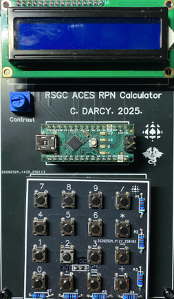
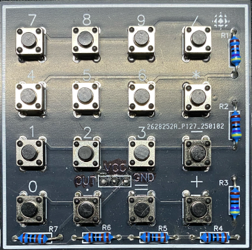
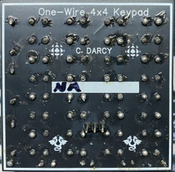
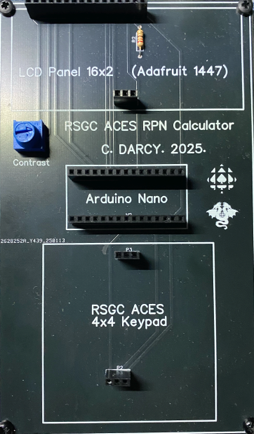

# RPN Calculator

A handheld **Reverse Polish Notation (RPN)** calculator on a custom PCB: a 4x4 keypad for input, a 16x2 LCD for output and an Arduino Nano running a hand-written floating-point stack in C++.

<p align="center">
  
</p>


## Overview

In RPN (postfix) notation the operator comes after its operands, so `3 4 +` means 3 + 4 and brackets are never needed. Evaluation is naturally stack-based: push operands, and when an operator arrives pop two values, compute and push the result.

**How the firmware works**

- A custom `Stack` class (`Stack.h` / `Stack.cpp`) stores `float` values with `push()`, `pop()`, `peek()` and full/empty checks.
- `setup()` initialises the LCD and serial, then shows a welcome message.
- `loop()` reads the keypad (resistor-ladder keypad on a single analog line); digits and the decimal point are buffered in a string.
- Pressing **Enter (`=`)** converts the buffer with `toFloat()` and pushes it onto the stack.
- Pressing an operator pops the top two operands, performs the calculation and pushes and displays the result.

## Hardware

| Part | Role |
|------|------|
| Arduino Nano | Controller |
| 16x2 LCD | Display, with contrast potentiometer |
| 4x4 keypad PCB (16 buttons, 4x 10k and 3x 330 ohm resistors) | Input |
| Main PCB | Holds the Nano, LCD and keypad connector, replacing a rat's nest of wiring |

| Keypad PCB (front) | Keypad PCB (back) | Main PCB |
|:---:|:---:|:---:|
|  |  |  |

## Repository layout

```
rpn-calculator/
├── firmware/rpn_calculator/
│   ├── rpn_calculator.ino   # Main program
│   ├── Stack.h              # Float stack interface
│   └── Stack.cpp            # Float stack implementation
├── docs/images/
├── LICENSE
└── README.md
```

## Build and run

1. Open `firmware/rpn_calculator/rpn_calculator.ino` in the Arduino IDE (it picks up `Stack.h` / `Stack.cpp` from the same folder).
2. Select **Arduino Nano** and upload.
3. Enter operands separated by `=`, then an operator, for example `3 = 4 = +`.

## What I learned

- Implementing a stack data structure in C++ for an embedded target
- Parsing user input into floats and evaluating postfix expressions
- Soldering and debugging a PCB with a keypad, LCD and microcontroller
- Splitting code into modular classes and header/implementation files

## Credits and notes

The keypad and PCB kit are from the ACES program (design credit C. D'Arcy); the firmware is my own. Project 2.8 of the Computer Engineering course (2025). MIT licensed.
